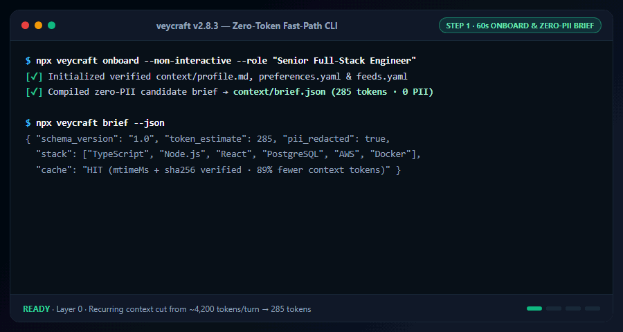
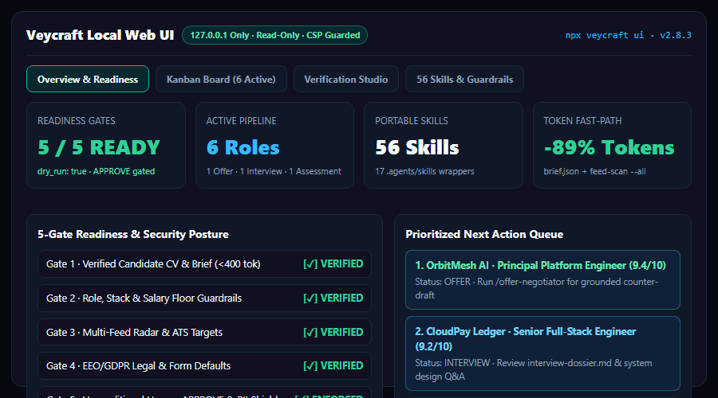
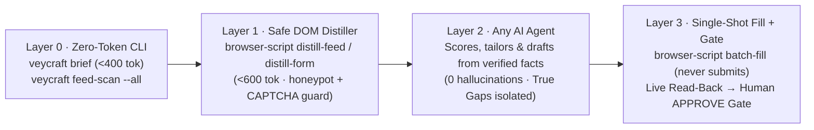

<div dir="rtl" align="right">

# Veycraft

**أداة CLI بصفر تبعيات، خادم MCP أصيل، و56 مهارة ذكاء اصطناعي للبحث عن الوظائف، العمل الحر العالمي، وإدارة مستودعات GitHub بدون `git clone` — داخل محرّر البرمجة الذي تستخدمه بالفعل.**

تُخفّض استهلاك التوكنز للمتصفح والسياق بنسبة **85%–95%** عبر المسار المحلي السريع بصفر توكنز (`brief`، `feed-scan`، مستخلص DOM الآمن، والتعبئة الفردية `batch-fill`) مع فرض **صفر خبرات مختلقة** و**بوابات موافقة بشرية صارمة (`APPROVE`)**.

[](https://www.npmjs.com/package/veycraft)
[](https://www.npmjs.com/package/veycraft)
[](package.json)
[](https://github.com/redasalem/veycraft/actions/workflows/validate-repo.yml)
[](https://github.com/redasalem/veycraft/security/code-scanning)
[](skills/REGISTRY.md)
[](mcp/README.md)
[](LICENSE)
[](https://glama.ai/mcp/servers/redasalem/veycraft)

**[الحزمة على npm ↗](https://www.npmjs.com/package/veycraft)** · **[معاينة تفاعلية ↗](https://redasalem.github.io/veycraft/)** · **[التشغيل في 60 ثانية](#التشغيل-في-60-ثانية)** · **[كيف يعمل](#كيف-يعمل)** · **[3 مسارات عملية](#3-مسارات-عمل-واقعية-للمطورين)** · **[ملخص الأوامر](#ملخص-أوامر-cli-والمسارات)** · **[الأمان والخصوصية](#ضمانات-الأمان-والخصوصية)** · **[English](README.md)**

> *(سابقًا `job-hunter-os` — تحويلات GitHub، ومجلدات `~/.job-hunter-os` القديمة، وأوامر `job-hunter` و`job-hunter-os` ما زالت مدعومة بالكامل.)*



---

## التشغيل في 60 ثانية

يتطلب **Node.js `>= 18.0.0`** (Windows وmacOS وLinux · `0` تبعيات تشغيل / `0` تبعيات تطوير · Playwright وNotion MCP اختياريان تمامًا).

<div dir="ltr" align="left">

```bash
# 1. تهيئة مساحة العمل وربط محرّر الذكاء الاصطناعي بأمان دون حذف إعداداتك
npx veycraft init

# 2. معالج الإعداد في 60 ثانية (ينشئ ملخص context/brief.json بأقل من 400 توكن)
npx veycraft onboard

# 3. مسح خلاصات الوظائف والفريلانس (RSS/JSON) محليًا بصفر توكنز للـ LLM
npx veycraft feed-scan --all
```

</div>

لتشغيل الواجهة المحلية للقراءة فقط (`127.0.0.1`) أو ربط خادم MCP الأصيل ذي الـ 8 أدوات بأمر واحد:

<div dir="ltr" align="left">

```bash
npx veycraft ui                          # واجهة ويب محلية من 5 تبويبات (Kanban، التحليلات، الاستوديو، 56 مهارة)
npx veycraft sync-mcp --with-veycraft    # ربط خادم Veycraft MCP مع نسخ احتياطية .veycraft.bak تلقائيًا
```

</div>

| المسار السريع لـ CLI بصفر توكنز (`brief` · `feed-scan` · `batch-fill` · `eval`) | الواجهة المحلية للقراءة فقط (`127.0.0.1` · 5 تبويبات · 0 طلبات خارجية) |
|---|---|
|  |  |

<details>
<summary>خيارات التثبيت البديلة (تثبيت عالمي، GitHub، الاستنساخ المصدري، ومسارات البيانات)</summary>

<div dir="ltr" align="left">

```bash
# تثبيت عالمي من npm
npm install -g veycraft
veycraft init --global && veycraft doctor --global

# أحدث نسخة من فرع main على GitHub
npx --yes github:redasalem/veycraft doctor

# تشغيل مباشر من المصدر (بدون خطوة build)
git clone https://github.com/redasalem/veycraft.git && cd veycraft
node bin/cli.mjs doctor
```

</div>

سكربتات التثبيت القابلة للفحص (`--dry-run` / `--uninstall`): [`scripts/install.sh`](scripts/install.sh) (macOS/Linux) و[`scripts/install.ps1`](scripts/install.ps1) (Windows PowerShell).

| البيئة | المسار الافتراضي لبيانات المستخدم (محفوظة عند التحديث) |
|---|---|
| **Windows (PowerShell / CMD)** | `%USERPROFILE%\.veycraft` (يحتفظ بـ `%USERPROFILE%\.job-hunter-os`) |
| **macOS** | `~/.veycraft` (يحتفظ بـ `~/.job-hunter-os`) |
| **Linux** | `~/.veycraft` أو `$XDG_DATA_HOME/veycraft` |
| **مسار مخصص / الوضع المحلي** | `VEYCRAFT_HOME=/custom/path` أو المجلد الحالي عبر `veycraft init` |

</details>

---

## كيف يعمل

ينفّذ Veycraft عمليات القراءة ومنع التكرار وتحليل الخلاصات المحمي ضد SSRF واستخراج DOM محليًا بـ Node.js الصافي حتى يستهلك نموذج الذكاء الاصطناعي التوكنز **في التقييم والتفصيل والكتابة الموثّقة فقط**:

<div dir="ltr" align="left">



</div>

### مقارنة استهلاك التوكنز (قبل وبعد)

*قياسات محلية على بيانات الاختبار وملفات مساحة العمل داخل المستودع (مقارنة محلية توضيحية وليست معيارًا خارجيًا):*

| مرحلة العمل | الأسلوب التقليدي لوكلاء المتصفح | المسار السريع في Veycraft | نسبة التوفير المقاسة |
|---|---|---|---|
| **تحميل سياق المرشّح المتكرر** | إعادة قراءة `cv.md` + `profile.md` + `github-projects.md` (`~3,500–5,500` توكن/دورة) | ملخص `context/brief.json` خالٍ من PII عبر `veycraft brief` (`< 400` توكن، `<= 1,550` بايت) | **توفير ~86%–92%** |
| **اكتشاف وفرز فرص الوظائف والفريلانس** | قراءة شجرة `browser_snapshot` كاملة لعدة صفحات (`~25,000–40,000` توكن/مسح) | رادار `veycraft feed-scan --all` محليًا (`~150` توكن/فرصة + تقرير `logs/radar/YYYY-MM-DD.md`) | **توفير ~90%–95%** |
| **فحص وتعبئة النماذج متعددة الحقول** | شجرة DOM كاملة + تعبئة حقل بحقل (`~15,000–25,000` توكن/نموذج) | `browser-script distill-form` + تعبئة موحدة `batch-fill` (`~600–1,200` توكن/نموذج، `0` إرسال) | **توفير ~85%–93%** |

<details>
<summary>مثال تفصيل موثّق بالحقائق (من بيانات العرض الاصطناعية <code>evals/fixtures/candidate-profile.md</code>)</summary>

<div dir="ltr" align="left">

```diff
- Built backend APIs for an e-commerce and payments app using Node.js.
+ Built idempotent Node.js and TypeScript webhook processors backed by PostgreSQL and AWS SQS,
+ reducing payment webhook p95 latency by 38% across $4.2M daily settlement volume [verified: candidate-profile.md].
! Blocked claim: "Managed multi-cluster Kubernetes" (0 verified years — isolated under True Gaps)
[ATS Keyword Coverage: 71.4% -> 92.8% (heuristic comparison, not an ATS guarantee)]
[Status: dry_run: true · Awaiting explicit job-specific human APPROVE]
```

</div>

</details>

---

## 3 مسارات عمل واقعية للمطورين

### 1. البحث عن الوظائف وتفصيل الـ CV لـ ATS بصدق
- **الأوامر:** `npx veycraft feed-scan --all` · `/quick-tailor` · `/tailor-cv` · `/apply-url <url>` · `/daily-run`
- يمسح الخلاصات محليًا بتقييم `Fit Score (0–100)`، ويُنتج سيرة ذاتية أحادية العمود (`HTML` + `TXT` + `.doc` متوافق مع Word بدون تزوير `.docx`) مع **خريطة أدلة** ومقارنة كلمات ATS وعزل المهارات الناقصة في **`True Gaps`**، ثم يتوقف عند جدول قراءة DOM الحي بانتظار موافقة بشرية صريحة `APPROVE`.

### 2. العمل الحر العالمي عبر المتصفح الحقيقي
- **الأوامر:** `/freelance-service` ([المهارة 55](skills/55-freelance-profile-and-service-publisher.md)) · `/freelance-bid` ([المهارة 56](skills/56-freelance-offer-radar-and-batch-bidder.md))
- يعمل عبر **Upwork وFiverr وFreelancer وMalt ومستقل وخمسات** أو أي منصة مخصصة: يكتب باقات خدمات محسّنة لـ SEO مع صورة غلاف مخصصة مبنية على `context/cv.md` و`context/github-projects.md`، ويصفّي المشاريع المفتوحة حسب المهارات والميزانية وجودة العميل، ويصيغ عروضًا موجزة تحفظ ملكيتك الفكرية مع تسجيلها في `tracker/freelance-proposals.md` (معزول عن Git)، ولا ينشر أو يقدّم إلا بعد **`APPROVE PUBLISH`** أو **`APPROVE <numbers>`**.

### 3. إدارة مستودعات GitHub عن بُعد بدون `git clone`
- **الأوامر:** `/github-remote` ([المهارة 54](skills/54-github-cli-remote-manager.md)) · `/github-audit` ([المهارة 11](skills/11-portfolio-and-github-auditor.md))
- يتصفح بنية المستودعات، ويعدّل الملفات عبر REST Contents API، وينفّذ commits ذرّية متعددة الملفات عبر Git Data API، ويحدّث المواضيع والإعدادات والـ PRs وActions عبر `gh` CLI دون الحاجة لاستنساخ محلي، ويستخرج مشاريع موثّقة بالكود إلى `context/github-projects.md`.

*مسارات مستقلة إضافية (لا تفرض `/setup`):* **`/demo`** (محاكاة 15 ثانية) · **`/profile-update`** · **`/linkedin-growth`** · **`/build-portfolio`** · **`/portfolio-design`** · **`/weekly-report`** — راجع [`docs/SKILL_CATALOG.md`](docs/SKILL_CATALOG.md) و[`docs/chat-commands.md`](docs/chat-commands.md).

---

## ملخص أوامر CLI والمسارات

الأدلة الكاملة: **[فهرس الـ 56 مهارة](docs/SKILL_CATALOG.md)** · **[أوامر المحادثة](docs/chat-commands.md)** · **[دليل خادم MCP](mcp/README.md)**

| الأمر | الوظيفة |
|---|---|
| `veycraft init [--global] [--ide <name>]` | تهيئة مساحة العمل (`~/.veycraft` أو محليًا) وربط مهارات المحررات وMCP بأمان |
| `veycraft onboard [--non-interactive \| --stdin]` | معالج إعداد في 60 ثانية ينشئ ملفات `context/` وملخص `context/brief.json` (`< 400` توكن) |
| `veycraft brief [--refresh] [--json]` | بناء/قراءة ملخص المرشّح الخالي من PII مع كاش ذكي عبر `mtimeMs + sha256` |
| `veycraft feed-scan --all [--json]` | مسح خلاصات RSS/Atom/JSON (`حد أقصى 4` متزامنة، محمي من SSRF) ← `logs/radar/YYYY-MM-DD.md` |
| `veycraft browser-script distill-feed\|distill-form\|batch-fill` | توليد سكربتات استخراج DOM أو تعبئة نماذج موحدة آمنة بلا أي إرسال تلقائي |
| `veycraft ui [--port <n>] [--no-open]` | تشغيل الواجهة المحلية للقراءة فقط على `127.0.0.1` (الجاهزية، Kanban، التحليلات، الاستوديو، 56 مهارة) |
| `veycraft mcp [--global]` | تشغيل خادم MCP أصيل عبر `stdio` (`8` أدوات قراءة فقط بلا شبكة + موارد `veycraft://`) |
| `veycraft doctor [--global] [--strict] [--json]` | فحص Node والأصل والـ 56 مهارة والبوابات الـ 5 وخطاف الخصوصية وإعدادات MCP |
| `veycraft eval [--baseline \| --journeys]` | تشغيل اختبارات التقييم الحتمية (`20/20`) ومصفوفة الرحلات (`132/132`) |
| `veycraft route` / `audit` / `verify` / `pre-submit` | توجيه الطلبات الطبيعية، تدقيق الـ CV محليًا، التحقق من المخرجات، وفرض الحدود ومنع الكليشيهات |

<details>
<summary>الأوامر المتقدمة (محرك الجلسات، السجل الذرّي، مزامنة Notion، والصيانة)</summary>

| الأمر | الوظيفة |
|---|---|
| `veycraft career summary\|analytics\|dashboard\|next [--json]` | ملخص التقديمات، تحليلات `MIN_N = 5`، لوحة Kanban HTML محلية، وقائمة الأولويات |
| `veycraft career run-start\|run-triage\|run-enqueue\|prepare\|run-checkpoint\|run-resume\|run-finish` | محرك الجلسة اليومية وفرز `Tier A/B/C` وطابور الموافقة المرحلية ونقاط الحفظ |
| `veycraft career record\|reserve\|confirm-submit\|transition\|skip\|cv-register` | تعديلات ذرّية محمية بقفل (`logs/.ledger.lock`) على السجل وإصدارات الـ CV |
| `veycraft career sync <preview\|status\|verify-schema\|approve\|mark-in-flight\|apply-receipt\|reconcile>` | مزامنة أحادية الاتجاه إلى Notion بقاطع أمان حي (`--plan-hash` + صلاحية 24 ساعة؛ بلا كتابة خارجية من CLI) |
| `veycraft sync-mcp [--with-veycraft] [--dry-run]` / `status` / `proof` / `bundle` / `backup` / `update` | مزامنة MCP (مع نسخ `.veycraft.bak`)، فحص الحدود، توليد بطاقة الإثبات، النسخ الاحتياطي، أو التحديث الموقّع بـ SSH |

*(الأسماء البديلة القديمة `job-hunter` و`job-hunter-os` تعمل بنفس الكفاءة. ضع `--global` قبل `career` عند استخدام الأوامر الفرعية مثل `veycraft --global career sync status`.)*

</details>

---

## يعمل مع كل وكلاء البرمجة بالذكاء الاصطناعي

**Claude Code** · **Gemini CLI** · **OpenAI Codex CLI** · **Cursor** · **Windsurf** · **GitHub Copilot / VS Code** · **Antigravity** · **خوادم MCP** *(بالإضافة إلى Devin Desktop وCline وRoo Code وOpenCode وAWS Kiro وJetBrains Junie وZed وGoose وAider — [`docs/COMPATIBILITY.md`](docs/COMPATIBILITY.md))*

<div dir="ltr" align="left">

```bash
# اكتشاف برمجي منظم عبر JSON (صفر تعديلات على الملفات، صفر شبكة)
veycraft --version --json && veycraft doctor --json && veycraft route "scan freelance bids" --json
```

</div>

<details>
<summary>ربط محرّر محدد (خيارات <code>--ide</code> وإعداد MCP اليدوي)</summary>

<div dir="ltr" align="left">

```bash
veycraft init --global --ide codex       # ~/.codex/AGENTS.md + config.toml + ~/.agents/skills
veycraft init --global --ide claude      # ~/.claude/commands + ~/.claude/skills + ~/.claude.json
veycraft init --global --ide gemini      # ~/.gemini/GEMINI.md + settings.json + ~/.gemini/skills
veycraft init --global --ide copilot     # ~/.copilot/copilot-instructions.md + mcp-config.json
veycraft init --global --ide cursor      # ~/.cursor/rules/job-hunter.mdc + ~/.cursor/mcp.json
veycraft init --global --ide windsurf    # ~/.windsurf/rules/ + workflows + mcp_config.json
veycraft init --global --ide antigravity # ~/.gemini/antigravity/global_workflows + mcp_config.json
```

```json
{ "mcpServers": { "veycraft": { "command": "npx", "args": ["-y", "veycraft", "mcp"] } } }
```

</div>

</details>

---

## ضمانات الأمان والخصوصية

يفصل Veycraft بوضوح بين **الإنفاذ الحتمي في الكود** و**قواعد عمل الوكيل** ([`docs/execution-safety.md`](docs/execution-safety.md) · [`SECURITY.md`](SECURITY.md)):

- **0 / 0 تبعيات npm:** مبني بمكتبة Node.js القياسية فقط (`dependencies: {}`, `devDependencies: {}`) دون خوادم سحابية أو مفاتيح API خارجية.
- **واجهة ويب محلية على `127.0.0.1` فقط:** لوحة قراءة فقط محمية بسياسات CSP صارمة وفحص `Host`/`Origin` دون أي طلبات خارجية.
- **خادم MCP خالٍ من PII بـ 8 أدوات قراءة فقط:** اتصال `stdio` محلي بالكامل (`veycraft_doctor`، `veycraft_route`، `veycraft_audit`، `veycraft_verify`، `veycraft_pre_submit`، `veycraft_career_summary`، `veycraft_career_next`، `veycraft_get_skill`) وموارد `veycraft://` المسموحة.
- **حماية SSRF مع تثبيت DNS (`SEC-01`) ومحلات محصّنة (`SEC-03`/`SEC-04`):** كل طلب وإعادة توجيه في `feed-scan` يفحص عناوين IP المحلولة ضد الشبكات الداخلية مع حد أقصى للحجم، مع حماية صارمة لـ ZIP/DOCX ومسارات العمل.
- **الدفاع ضد حقن الأوامر وحقول الفخ (Honeypot):** تنقية أوصاف الوظائف وعروض الفريلانس من محارف BiDi/Unicode الخفية ومعاملتها كـ `UNTRUSTED_EXTERNAL_DATA` مع عزل حقول الـ honeypot وتركها فارغة تمامًا.
- **عزل صارم في Git وحزم npm:** مجلدات `context/*` (عدا `*.example`) و`logs/` و`logs/radar/` و`tracker/` و`*.pdf` و`browser-profile/` و`.env` محجوبة بـ `.gitignore` وخطاف `.git/hooks/pre-commit` وفحص `npm run pack:check`.
- **بوابات موافقة بشرية غير مشروطة (`APPROVE`):** وضع `dry_run: true` افتراضي، وأداة `batch-fill` لا تستدعي `.submit()` ولا تضغط Submit/Publish أبدًا، وكل إجراء حي ينتظر موافقة بشرية صريحة (`APPROVE` / `APPROVE PUBLISH` / `APPROVE <numbers>`).


---

## التحديث والإزالة والتطوير

التحديث أو إزالة أداة CLI **لا يحذف ولا يستبدل أبدًا** ملفاتك الخاصة في `context/` أو `logs/` أو `tracker/` أو `config/guardrails.yaml` أو `browser-profile/`.

<div dir="ltr" align="left">

```bash
# تحديث الأداة عالميًا وتحديث المهارات بأمان
npm update -g veycraft && veycraft update --global

# إزالة الأداة العالمية فقط (تبقى بياناتك في ~/.veycraft سليمة)
npm uninstall -g veycraft

# تشغيل كامل اختبارات التحقق (20/20 تقييم · 132/132 رحلة · 116/116 اختبار وحدة)
npm run prepublishOnly && node --test evals/*.test.mjs
```

</div>

- **فهرس الوثائق:** [`AGENTS.md`](AGENTS.md) · [`skills/REGISTRY.md`](skills/REGISTRY.md) · [`docs/ARCHITECTURE.md`](docs/ARCHITECTURE.md) · [`docs/SKILL_CATALOG.md`](docs/SKILL_CATALOG.md) · [`docs/chat-commands.md`](docs/chat-commands.md) · [`docs/COMPATIBILITY.md`](docs/COMPATIBILITY.md) · [`docs/execution-safety.md`](docs/execution-safety.md) · [`PLATFORMS.md`](PLATFORMS.md) · [`ACCEPTANCE.md`](ACCEPTANCE.md) · [`CONTRIBUTING.md`](CONTRIBUTING.md) · [`CHANGELOG.md`](CHANGELOG.md) · [`HIRED.md`](HIRED.md)

## الرخصة والأصل

مرخص تحت رخصة [MIT](LICENSE) — Copyright (c) 2026 Reda Salem (`@redasalem`). راجع [`NOTICE`](NOTICE) و[`AUTHORS.md`](AUTHORS.md) و[`PROVENANCE.json`](PROVENANCE.json).

</div>
