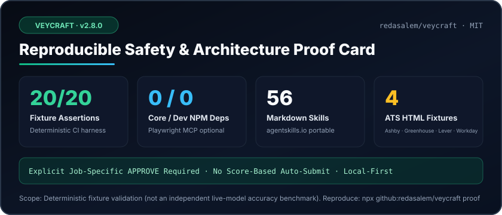

<div dir="rtl" align="right">

# Veycraft

**عمليات مهنية أصيلة لوكلاء الذكاء الاصطناعي، تفصيل سيرة ذاتية موثّق بالحقائق، ومحرك ذكاء البروفايل داخل محرّر البرمجة الذي تستخدمه بالفعل.**

[](package.json)
[](package.json)
[](skills/REGISTRY.md)
[](.github/workflows/validate-repo.yml)
[](LICENSE)

**[معاينة تفاعلية ↗](https://redasalem.github.io/veycraft/)** · **[البداية السريعة](#البداية-السريعة)** · **[توجيه وكلاء الذكاء الاصطناعي](#تثبيت-وتشغيل-Veycraft-عبر-وكلاء-الذكاء-الاصطناعي)** · **[مرجع CLI](#أوامر-cli)** · **[التحديث والإزالة](#التحديث-والإزالة)** · **[English](README.md)**

> *(سابقًا `job-hunter-os` — تحويلات GitHub التلقائية ومجلدات `~/.job-hunter-os` السابقة وأوامر `job-hunter` و`job-hunter-os` ما زالت مدعومة بالكامل دون فقدان أي بيانات.)*

---

## لماذا Veycraft؟

أعطِ وكيل البرمجة الذي تستخدمه بالفعل (**OpenAI Codex، Claude Code، Gemini CLI، GitHub Copilot، Cursor، Windsurf، Antigravity، Cline، OpenCode**) سيرتك الذاتية ووصف وظيفة واحدة — أو اطلب بلغة طبيعية بالعربية أو الإنجليزية. ينتج لك Veycraft سيرة ذاتية مفصّلة وموثّقة (`HTML / TXT / .doc متوافق مع Word`)، و**خريطة أدلة (`Evidence Map`)**، و**مقارنة كلمات ATS**، و**خطة تحديث بروفايل محققة بالمخطط**، وقائمة واضحة بـ **الفجوات الحقيقية (`True Gaps`)**.

- **صفر خبرات مختلقة:** كل رقم ومهارة وشركة وتاريخ يرتبط بحقائق مؤكدة من ملفك المحلي فقط.
- **صفر إرسال أعمى:** وضع `dry_run: true` مفعّل افتراضيًا، وأي تقديم حي أو حفظ تعديل على البروفايل يتطلب موافقة بشرية صريحة (`APPROVE`).
- **صفر تبعيات npm:** أداة CLI مبنية بـ Node.js القياسي فقط (`dependencies: {}`, `devDependencies: {}`) مع 50 مهارة Markdown محمولة، بدون مفاتيح API خارجية أو خوادم سحابية.

---

## البداية السريعة

اختر أحد مسارات التثبيت الثلاثة (جميعها آمنة ولا تعدّل بياناتك الشخصية):

### 1. تجربة فورية بدون تثبيت (`npx`)
جرّب Veycraft فورًا من أي مجلد دون استنساخ المستودع أو كتابة بيانات شخصية:

<div dir="ltr" align="left">

```bash
# يعمل مباشرة اليوم من GitHub (Windows PowerShell/CMD وmacOS وLinux):
npx --yes github:redasalem/veycraft --help
npx --yes github:redasalem/veycraft doctor

# الأمر المختصر عبر npm (اسم الحزمة `veycraft` متاح ومُجهّز للنشر فور موافقة المالك):
# npx --yes veycraft --help
```

</div>

### 2. تثبيت عالمي لأداة CLI (`npm install -g`)
ثبّت الأمر `veycraft` مرة واحدة واستخدمه من أي مسار:

<div dir="ltr" align="left">

```bash
# يعمل مباشرة اليوم من GitHub:
npm install -g github:redasalem/veycraft

# الأمر المختصر عبر npm (بعد النشر على npm):
# npm install -g veycraft

# التحقق الفوري:
veycraft --help
veycraft --version
veycraft doctor
```

</div>

### 3. التثبيت من المصدر للمطورين والمساهمين (`git clone`)
شغّل الأداة مباشرة من الكود المصدري دون أي خطوات بناء (`build`):

<div dir="ltr" align="left">

```bash
git clone https://github.com/redasalem/veycraft.git
cd veycraft
node bin/cli.mjs --help
node bin/cli.mjs doctor

# اختياري: ربط الأمر `veycraft` محليًا أثناء التطوير
npm link
```

</div>

*(تتوفر أيضًا سكربتات تثبيت مفتوحة وقابلة للفحص مع خيارات `--dry-run` و`--uninstall` في [`scripts/install.sh`](scripts/install.sh) لأنظمة macOS/Linux و[`scripts/install.ps1`](scripts/install.ps1) لـ Windows PowerShell — يُنصح دائمًا بفحص السكربت قبل تشغيله بدل تمرير سكربتات خارجية مباشرة إلى الـ shell.)*

---

## المتطلبات

| المتطلب | التفاصيل |
|---|---|
| **Node.js** | `>= 18.0.0` (مختبَر على Node 22+ عبر Ubuntu وmacOS وWindows) |
| **أنظمة التشغيل** | Windows 10/11 (PowerShell وCMD)، وmacOS، وLinux (يحترم `VEYCRAFT_HOME` و`XDG_DATA_HOME`) |
| **التبعيات** | **0 تبعيات تشغيل و0 تبعيات تطوير** في `package.json` |
| **أدوات اختيارية** | Playwright MCP (فقط لتعبئة النماذج الحيّة أو تصدير PDF) · Notion MCP (فقط عند الرغبة في المزامنة مع Notion) |

---

## أول تشغيل آمن (قراءة فقط ثم تهيئة موجهة)

<div dir="ltr" align="left">

```bash
# 1. فحص البيئة والأصل والجاهزية (قراءة فقط، مع دعم --json لوكلاء الذكاء الاصطناعي)
veycraft doctor
veycraft doctor --json

# 2. تهيئة المجلد العالمي (~/.veycraft) وربط مهارات وإعدادات MCP بأمان دون حذف قواعدك
veycraft init --global

# 3. فحص محلي فوري لأي سيرة ذاتية (.md, .txt, .docx, .html, .doc)
veycraft audit ./resume.docx --share

# 4. اختبار توجيه المهام باللغة الطبيعية دون تعديل أي ملفات
veycraft route "حسّن ملفي المهني على LinkedIn وزامنه مع السيرة الذاتية" --json
```

</div>

داخل محرّر الذكاء الاصطناعي، ابدأ بـ:
- **`/demo`** — محاكاة اصطناعية في 15 ثانية ([`examples/sandbox-demo/`](examples/sandbox-demo/sample-jds.md)) بدون أي بيانات شخصية أو تسجيل دخول.
- **`/quick-tailor`** — تفصيل سيرتك لوظيفة واحدة (`HTML / TXT / .doc` + `True Gaps`) بدون متصفح.
- **`/profile-update`** — تحليل وتخطيط تحسينات البروفايل عبر المنصات بوضع `DRAFT_ONLY` ومخطط مُتحقق منه.
- **`/setup` ← `/daily-run`** — النظام الكامل الاختياري عند الحاجة لأتمتة المتصفح.

---

## تثبيت وتشغيل Veycraft عبر وكلاء الذكاء الاصطناعي

يدعم Veycraft بشكل أصيل كلًا من **OpenAI Codex CLI** و**Claude Code** و**Gemini CLI** و**GitHub Copilot / VS Code** و**Cursor** و**Windsurf** و**Antigravity** و**Devin Desktop** و**Cline** و**Roo Code** و**OpenCode** و**AWS Kiro** و**JetBrains Junie** و**Zed** و**Goose** و**Aider** (راجع [`docs/COMPATIBILITY.md`](docs/COMPATIBILITY.md)).

### أمر توجيه موحّد (انسخه والصقه لأي وكيل ذكاء اصطناعي)
<div dir="ltr" align="left">

```text
Install Veycraft, verify it with `veycraft doctor --json`, explain available capabilities,
and prepare it for this workspace. Do not modify personal data or perform live external
actions without explicit approval.
```

</div>

### ربط أداة ذكاء اصطناعي محددة فقط
<div dir="ltr" align="left">

```bash
veycraft init --global --ide codex       # ~/.codex/AGENTS.md + config.toml + ~/.agents/skills
veycraft init --global --ide claude      # ~/.claude/commands + ~/.claude/skills + ~/.claude.json
veycraft init --global --ide gemini      # ~/.gemini/GEMINI.md + settings.json + ~/.gemini/skills
veycraft init --global --ide copilot     # ~/.copilot/copilot-instructions.md + mcp-config.json
veycraft init --global --ide cursor      # ~/.cursor/rules/job-hunter.mdc + ~/.cursor/mcp.json
veycraft init --global --ide windsurf    # ~/.windsurf/rules/ + workflows + mcp_config.json
veycraft init --global --ide antigravity # ~/.gemini/antigravity/global_workflows + mcp_config.json
```

</div>

**اكتشاف برمجي منظم للوكلاء (`JSON`):** تدعم الأوامر `veycraft --version --json` و`veycraft doctor --json` و`veycraft status --json` و`veycraft route "<request>" --json` إخراج JSON منظم دون تعديل ملفات شخصية أو تنفيذ أي إجراءات خارجية.

---

## القدرات الأساسية ومعاينة المخرجات

جميع الأسماء والشركات والأرقام في المعاينة أدناه هي بيانات عرض اصطناعية من [`evals/fixtures/`](evals/fixtures/candidate-profile.md):


<div dir="ltr" align="left">

```diff
- Built backend APIs for an e-commerce and payments app using Node.js.
+ Built idempotent Node.js and TypeScript webhook processors backed by PostgreSQL and AWS SQS,
+ reducing payment webhook p95 latency by 38% across $4.2M daily settlement volume [verified: candidate-profile.md].
! Blocked claim: "Managed multi-cluster Kubernetes" (0 verified years — isolated under True Gaps)
[ATS Keyword Coverage: 71.4% -> 92.8% (heuristic comparison, not an ATS guarantee)]
[Status: dry_run: true · Awaiting explicit job-specific human APPROVE]
```

</div>

| القدرة | الأمر / التفعيل | أبرز المزايا |
|---|---|---|
| **تفصيل سيرة ذاتية موثّق** | `/quick-tailor` أو `/tailor-cv` أو طلب طبيعي | `HTML + TXT + .doc` متوافق مع Word (بدون تزوير `.docx`)، خريطة أدلة، مقارنة كلمات ATS، عزل `True Gaps`، والحفاظ على الملف الأصلي |
| **محرك ذكاء البروفايل** | `/profile-update` أو *"حسّن ملفي المهني"* | تدقيق من 7 معايير عبر `linkedin` و`wellfound` و`ats` و`job_boards` و`portfolio` ووضع `generic` الاحتياطي، وخطة `DRAFT_ONLY` (`add`/`replace` فقط بلا `remove`) والتحقق بالقراءة بعد الحفظ |
| **نمو وSEO لينكدإن** | `/linkedin-growth` | فصل صارم بين القراءة فقط، والمسودات `DRAFT_ONLY`، والتعديل الحي المشروط بـ `APPROVE` مع مسودات تواصل `<= 75` كلمة |
| **اكتشاف متعدد المصادر وتجهيز ATS** | `/daily-run` أو `/apply-url <url>` | يدعم LinkedIn وWellfound وIndeed وGreenhouse وLever وAshby وWorkday وبوابات الشرق الأوسط وشبكات العقود B2B أو أي رابط وظيفة HTTPS مباشر |
| **المقابلات والعروض والعقود** | طلب باللغة الطبيعية | `interview-dossier.md`، خطط اختبارات تقنية، مسودات تفاوض راتب، وتدقيق بنود عقود وNDA |
| **وضع العمل المحلي الكامل** | `veycraft bundle` / مصفوفة البدائل `A–E` | يعمل 100% محليًا بدون Playwright أو Notion مع بدائل جاهزة للنسخ والرفع اليدوي |

---

## أوامر CLI

الأسماء البديلة القديمة `job-hunter` و`job-hunter-os` تشير لنفس الملف التنفيذي `bin/cli.mjs` حفاظًا على التوافق العكسي.

| الأمر | الوظيفة |
|---|---|
| `veycraft --help` / `veycraft --version [--json]` | عرض دليل الاستخدام (قراءة فقط) أو الإصدار وبيانات الأصل |
| `veycraft doctor [--global] [--strict] [--json]` | فحص Node والأصل والـ 50 مهارة والبوابات الـ 5 وحداثة الكتيبات وخطاف الخصوصية وإعدادات MCP |
| `veycraft init [--global] [--force] [--ide <name>]` | تهيئة `~/.veycraft` (أو المجلد الحالي) وربط مهارات المحررات ومزامنة MCP دون حذف القواعد القائمة |
| `veycraft route "<request>" [--json]` | توجيه أي طلب طبيعي (عربي أو إنجليزي) لأقل مجموعة مهارات مناسبة مع البديل الآمن |
| `veycraft audit <cv.md\|txt\|docx\|html\|doc> [--share]` | فحص محلي للسيرة الذاتية وكشف `.docx` المزيف والـ PDF المصوّر وروابط SSRF وإنتاج بطاقة خالية من PII |
| `veycraft verify <dir\|file> [--facts <json\|md>]` | التحقق بعد الكتابة من المخرجات وسجلات التقديم ونقاط حفظ الجلسة (`current-session-checkpoint.json`) وإصدارات الـ CV وخطط/حالة Notion وخطط `Profile Update Plan` ومخزن الحقائق |
| `veycraft career summary [--json]` | عرض ملخص التقديمات الفعلية والمقابلات الجارية والمتابعات المتأخرة وحالة مزامنة Notion (`logs/sync-state.json` أولاً) |
| `veycraft career analytics [--period <all\|YYYY-Www\|YYYY-MM>] [--write] [--json]` | تحليلات حتمية لقمع التوظيف وشرائح التطابق وإصدارات السيرة والمصادر (`MIN_N = 5`، والصمت `>= 14` يومًا لا يُحسب رفضًا) |
| `veycraft career dashboard [--no-open]` | توليد لوحة تحكم HTML محلية للقراءة فقط (تحليلات + Kanban) بدون أي استدعاءات خارجية |
| `veycraft career migrate [--dry-run \| --apply] [--json]` | ترقية آمنة مع نسخة احتياطية لسجل `logs/applications-log.json` إلى مخطط `v2.0` (`--dry-run` افتراضيًا) |
| `veycraft career cv-versions [--json]` | استعراض إصدارات السيرة الذاتية للمالك في `logs/cv-versions.json` مع عزل صارم لملفات الغير |
| `veycraft career next [--job-id <id>] [--persona <id>] [--lang <code>] [--json]` | قائمة أولويات للقراءة فقط تعرض عوائق الأمان `P0` وطابور التجهيز واختيار أنسب CV ومتابعات 7 أيام وفحص صمت 14 يومًا |
| `veycraft career run-start\|run-triage\|run-enqueue\|prepare\|run-checkpoint\|run-resume\|run-finish [--help]` | محرك الجلسة اليومية ونقاط الحفظ (`checkpoint`) وفرز `Tier A/B/C` وطابور الموافقة المرحلية (`submission_authorized: false`) والتحقق من حزمة التقديم |
| `veycraft career record\|reserve\|confirm-submit\|transition\|skip\|cv-register [--help]` | كتابة ذرّية محمية بقفل (`logs/.ledger.lock`) ومحققة بالمخطط لسجل التقديمات والمستبعدات وإصدارات الـ CV (+ `lock-status` و`release-stale-lock` و`recover-tx`) |
| `veycraft career sync <subcommand> [--help]` | محرك مزامنة أحادي الاتجاه إلى Notion (`preview` و`status` و`verify-schema` و`approve` و`mark-in-flight` و`apply-receipt` و`record-failure` و`expire-stale` و`reconcile` و`reset-permanent` و`release-stale-lock`) دون أي كتابة خارجية من الـ CLI |
| `veycraft pre-submit [--draft <f> \| --text <t>] [--platform <p> --company <c> --title <t> --url <u> --job-id <id>] [--json]` | فرض الحد اليومي وحدود الإحماء 1–3 (مع احتساب حجوزات `submission_uncertain`) وحدود المنصات وقواطع الحماية والقائمة السوداء ومنع التكرار والكليشيهات وحد `<= 75` كلمة |
| `veycraft eval [--baseline \| --file <json> \| --journeys]` | تشغيل 20 اختبارًا حتميًا أو تقييم نموذج خارجي أو كامل حزمة اختبارات التكامل عبر `node:test` |
| `veycraft status [--global] [--json]` | عرض حالة البوابات والحد اليومي وملخص التقديمات |
| `veycraft proof` / `dashboard [--global] [--no-open]` / `bundle` | توليد بطاقة الإثبات، فتح لوحة Kanban الكلاسيكية، أو تصدير برومبت ويب شات موحد |
| `veycraft sync-mcp` / `login` / `unlock` / `backup` / `update` | مزامنة MCP، فتح متصفح دائم، إزالة الأقفال العالقة، النسخ الاحتياطي الشامل، أو التحديث الموقّع بـ SSH |

*(ملاحظة: عند تمرير `--global` أو `-g` مع أوامر `career` مثل `career sync` أو `career record` أو `career next`، ضعه قبل `career`، مثلًا: `veycraft --global career sync status`.)*

---

## الخصوصية والأمان وبوابات الموافقة

يفصل Veycraft بوضوح بين **الفحوصات الحتمية في الكود** و**قواعد عمل الوكيل** ([`docs/execution-safety.md`](docs/execution-safety.md)):

- **ضوابط CLI الحتمية (`bin/cli.mjs`، `bin/profile-intelligence.mjs`، `bin/career-intelligence.mjs`، `bin/notion-sync.mjs`):** فرض صلاحيات المنصات من السجل، التحقق من الحقائق والمخططات (`verify`)، كشف التوكنات وSSRF و`.docx` المزيف (`audit`)، فحص الحدود ومنع التكرار والقائمة السوداء والكليشيهات (`pre-submit`)، كتابة ذرّية محمية بقفل ومعاملات قابلة للتراجع (`logs/.ledger.lock` و`logs/.ledger-tx.json`)، عزل سير الغير ومعيار `MIN_N = 5` (`career`)، مزامنة Notion أحادية الاتجاه بقاطع أمان حي (`config/guardrails.yaml`) وتوقيع `--plan-hash` وصلاحية 24 ساعة وإيصالات موثّقة (`career sync`)، خطاف `.git/hooks/pre-commit` لمنع تسريب PII، والتحقق بتوقيع SSH (`update`).
- **بوابات الوكيل:** الحماية من حقن الأوامر في صفحات الويب، قاعدة رفع الـ CV أولاً، جدول قراءة DOM الحي، وضع `DRAFT_ONLY` افتراضيًا، قاطع الحماية 24 ساعة، وموافقة بشرية صريحة (`APPROVE`) قبل أي إرسال أو حفظ.
- **حماية البيانات الخاصة:** مجلدات `context/*` (عدا `*.example`) و`logs/` و`*.pdf` و`browser-profile/` و`.env` محجوبة عن Git ومستبعدة تمامًا من حزمة npm (`npm run pack:check`).



---

## مسارات الإعدادات والبيانات

لا يقوم Veycraft مطلقًا بالكتابة فوق `context/` أو `logs/` أو `config/guardrails.yaml` أو `browser-profile/` أثناء التثبيت أو التحديث.

| البيئة | المسار الافتراضي لبيانات المستخدم |
|---|---|
| **Windows (PowerShell / CMD)** | `%USERPROFILE%\.veycraft` (يحتفظ تلقائيًا بأي مجلد سابق في `%USERPROFILE%\.job-hunter-os`) |
| **macOS** | `~/.veycraft` (يحتفظ تلقائيًا بأي مجلد سابق في `~/.job-hunter-os`) |
| **Linux** | `~/.veycraft`، أو `$XDG_DATA_HOME/veycraft` عند ضبط `XDG_DATA_HOME` صراحةً |
| **مسار مخصص (كل الأنظمة)** | عبر متغير البيئة `VEYCRAFT_HOME=/custom/path` |
| **الوضع المحلي داخل مشروع** | المجلد الحالي عند التشغيل بـ `veycraft init` (مع ملف `.veycraft-install.json`) |

---

## التحديث والإزالة

### التحديث (مع الحفاظ الكامل على بياناتك)
<div dir="ltr" align="left">

```bash
# عند التثبيت العالمي عبر GitHub / npm:
npm install -g github:redasalem/veycraft   # أو `npm update -g veycraft` بعد النشر على npm
veycraft update --global                   # يحدّث المهارات وروابط المحررات مع حفظ context/ و logs/

# عند ترقية نسخة قديمة مستنسخة من `job-hunter-os`:
git remote set-url origin https://github.com/redasalem/veycraft.git
git pull --ff-only origin main
```

</div>

### الإزالة الآمنة (لا تحذف بياناتك الشخصية)
إزالة أداة CLI **لا تمس** ملفات `context/` أو `logs/` أو `browser-profile/`:

<div dir="ltr" align="left">

```bash
# 1. إزالة الأمر العالمي فقط (تبقى بياناتك في ~/.veycraft سليمة):
npm uninstall -g veycraft

# 2. اختياري — حذف بيانات Veycraft المحلية نهائيًا فقط إذا أردت مسح كل شيء:
# macOS / Linux: rm -rf ~/.veycraft
# Windows PowerShell: Remove-Item -Recurse -Force "$HOME\.veycraft"
```

</div>

---

## التطوير والاختبار والمساهمة

<div dir="ltr" align="left">

```bash
git clone https://github.com/redasalem/veycraft.git
cd veycraft

npm test             # تشغيل eval --baseline (20/20) و live-agent-eval-run (20/20) و eval --journeys (17/17)
npm run pack:check   # التحقق من محتويات حزمة npm وخلوها من أي ملفات خاصة
node bin/cli.mjs doctor
```

</div>

- **فهرس الوثائق:** [`AGENTS.md`](AGENTS.md) · [`skills/REGISTRY.md`](skills/REGISTRY.md) · [`docs/ARCHITECTURE.md`](docs/ARCHITECTURE.md) · [`docs/SKILL_CATALOG.md`](docs/SKILL_CATALOG.md) · [`docs/COMPATIBILITY.md`](docs/COMPATIBILITY.md) · [`docs/chat-commands.md`](docs/chat-commands.md) · [`docs/execution-safety.md`](docs/execution-safety.md) · [`PLATFORMS.md`](PLATFORMS.md) · [`SECURITY.md`](SECURITY.md) · [`CHANGELOG.md`](CHANGELOG.md)
- **المساهمة:** راجع [`CONTRIBUTING.md`](CONTRIBUTING.md) و[`HIRED.md`](HIRED.md)، أو شارك نتيجة توظيف عبر [Share Outcome Issue](https://github.com/redasalem/veycraft/issues/new?template=share-success.yml).

## الرخصة والأصل

مرخص تحت رخصة [MIT](LICENSE) — Copyright (c) 2026 Reda Salem (`@redasalem`). راجع [`NOTICE`](NOTICE) و[`AUTHORS.md`](AUTHORS.md) و[`PROVENANCE.json`](PROVENANCE.json).

</div>
