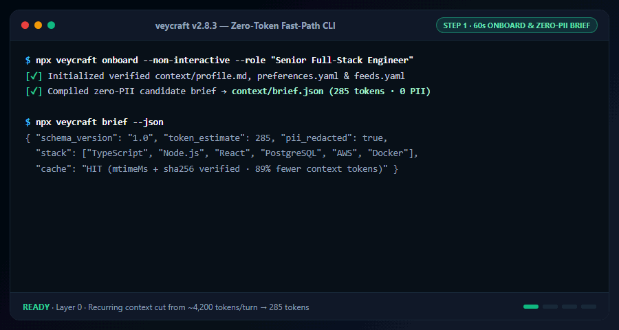
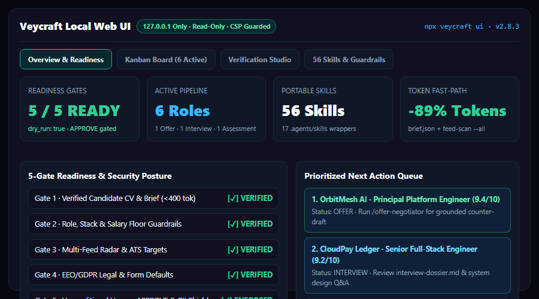
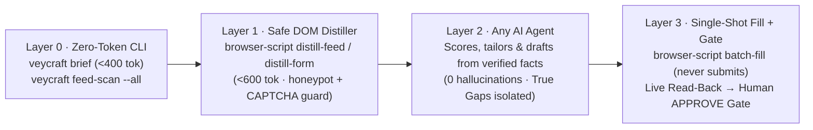
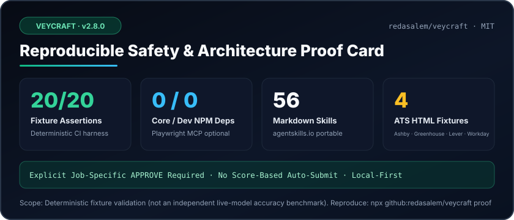

# Veycraft

**Zero-dependency CLI, native MCP server, and 56 AI skills for job hunting, global freelancing, and no-clone GitHub operations — inside the AI coding agent you already use.**

Cuts browser and context token usage by **85%–95%** via a local zero-token fast-path (`brief`, `feed-scan`, safe DOM distiller, single-shot batch fill) while enforcing **zero fabricated experience** and **unconditional human `APPROVE` gates**.

[](https://www.npmjs.com/package/veycraft)
[](https://www.npmjs.com/package/veycraft)
[](package.json)
[](https://github.com/redasalem/veycraft/actions/workflows/validate-repo.yml)
[](https://github.com/redasalem/veycraft/security/code-scanning)
[](skills/REGISTRY.md)
[](mcp/README.md)
[](LICENSE)
[](https://glama.ai/mcp/servers/redasalem/veycraft)

**[Live on npm ↗](https://www.npmjs.com/package/veycraft)** · **[Interactive Demo ↗](https://redasalem.github.io/veycraft/)** · **[60-Second Quickstart](#60-second-quickstart)** · **[How It Works](#how-it-works)** · **[3 Workflows](#3-real-world-developer-workflows)** · **[CLI Cheat Sheet](#cli--slash-command-cheat-sheet)** · **[Security](#security--privacy-guarantees)** · **[العربية (RTL)](README.ar.md)**

> *(Formerly `job-hunter-os` — GitHub redirects, existing `~/.job-hunter-os` homes, and `job-hunter` / `job-hunter-os` CLI aliases remain supported.)*



---

## 60-Second Quickstart

Requires **Node.js `>= 18.0.0`** (Windows, macOS, Linux · `0` runtime / `0` dev npm dependencies · Playwright & Notion MCP strictly optional).

```bash
# 1. Initialize workspace & link your AI coding IDE non-destructively
npx veycraft init

# 2. Run the 60-second onboarding wizard (compiles < 400-token context/brief.json)
npx veycraft onboard

# 3. Scan configured RSS/JSON job & freelance feeds locally at 0 LLM tokens
npx veycraft feed-scan --all
```

Launch the read-only local Web UI (`127.0.0.1`) or wire the native 8-tool MCP server into your IDE in one line:

```bash
npx veycraft ui                          # 5-tab local UI: Readiness, Kanban, Analytics, Studio, 56 Skills
npx veycraft sync-mcp --with-veycraft    # Safely registers Veycraft MCP with .veycraft.bak backups
```

| Zero-Token CLI Fast-Path (`brief` · `feed-scan` · `batch-fill` · `eval`) | Read-Only Local Web UI (`127.0.0.1` · 5 Tabs · 0 External Requests) |
|---|---|
|  |  |

<details>
<summary>Alternative Installs (Global npm, GitHub Latest, Source Clone &amp; OS Data Paths)</summary>

```bash
# Global install from npm
npm install -g veycraft
veycraft init --global && veycraft doctor --global

# Latest main directly from GitHub
npx --yes github:redasalem/veycraft doctor

# Source install (zero build step)
git clone https://github.com/redasalem/veycraft.git && cd veycraft
node bin/cli.mjs doctor
```

Inspectable shell installers (`--dry-run` / `--uninstall`): [`scripts/install.sh`](scripts/install.sh) (macOS/Linux) and [`scripts/install.ps1`](scripts/install.ps1) (Windows PowerShell).

| Environment | Default Agent Home &amp; User Data (Preserved on Upgrade) |
|---|---|
| **Windows (PowerShell / CMD)** | `%USERPROFILE%\.veycraft` (preserves `%USERPROFILE%\.job-hunter-os`) |
| **macOS** | `~/.veycraft` (preserves `~/.job-hunter-os`) |
| **Linux** | `~/.veycraft` or `$XDG_DATA_HOME/veycraft` |
| **Custom / Local Mode** | `VEYCRAFT_HOME=/custom/path` or current folder via `veycraft init` |

</details>

---

## How It Works

Veycraft keeps deterministic I/O, deduplication, SSRF-safe feed parsing, and DOM extraction in pure Node.js so your LLM spends tokens **only on judgment, tailoring, and grounded writing**:



### Token Footprint Comparison

*Measured on local repository fixtures and workspace profiles (illustrative local measurements, not an external benchmark):*

| Workflow Stage | Standard Browser-Agent Approach | Veycraft Fast-Path | Measured Reduction |
|---|---|---|---|
| **Recurring Candidate Context** | Re-reading `cv.md` + `profile.md` + `github-projects.md` (`~3,500–5,500` tokens/turn) | Cached zero-PII `context/brief.json` via `veycraft brief` (`< 400` tokens, `<= 1,550` bytes) | **~86%–92% fewer tokens** |
| **Job &amp; Freelance Feed Discovery** | Raw multi-page `browser_snapshot` trees (`~25,000–40,000` tokens/scan) | `veycraft feed-scan --all` local dedup &amp; shortlist (`~150` tokens/item + `logs/radar/YYYY-MM-DD.md`) | **~90%–95% fewer tokens** |
| **Multi-Field Form Inspection &amp; Fill** | Full accessibility tree + per-field tool loops (`~15,000–25,000` tokens/form) | `browser-script distill-form` + single-shot `batch-fill` (`~600–1,200` tokens/form, `0` submits) | **~85%–93% fewer tokens** |

<details>
<summary>Synthetic Grounded Tailoring Diff Example (from <code>evals/fixtures/candidate-profile.md</code>)</summary>

```diff
- Built backend APIs for an e-commerce and payments app using Node.js.
+ Built idempotent Node.js and TypeScript webhook processors backed by PostgreSQL and AWS SQS,
+ reducing payment webhook p95 latency by 38% across $4.2M daily settlement volume [verified: candidate-profile.md].
! Blocked claim: "Managed multi-cluster Kubernetes" (0 verified years — isolated under True Gaps)
[ATS Keyword Coverage: 71.4% -> 92.8% (heuristic comparison, not an ATS guarantee)]
[Status: dry_run: true · Awaiting explicit job-specific human APPROVE]
```

</details>

---

## 3 Real-World Developer Workflows

### 1. Job Hunting &amp; Truthful ATS Tailoring
- **Commands:** `npx veycraft feed-scan --all` · `/quick-tailor` · `/tailor-cv` · `/apply-url <url>` · `/daily-run`
- Scans public RSS/JSON boards locally with `Fit Score (0–100)`, tailors single-column `HTML` + `TXT` + Word-compatible `.doc` resumes (never fake `.docx`), produces an **Evidence Map** + 4-bucket **ATS Keyword Heatmap**, isolates missing skills under **True Gaps**, and pauses at a Live DOM Read-Back Table ahead of explicit human `APPROVE`.

### 2. Global Freelancing via Real Browser
- **Commands:** `/freelance-service` ([Skill 55](skills/55-freelance-profile-and-service-publisher.md)) · `/freelance-bid` ([Skill 56](skills/56-freelance-offer-radar-and-batch-bidder.md))
- Works across **Upwork, Fiverr, Freelancer, Malt, Mostaql, Khamsat**, or any custom marketplace URL: drafts SEO service packages + cover images grounded in `context/cv.md` &amp; `context/github-projects.md`, filters open projects by stack/budget/client quality, drafts concise IP-safe bids, logs to gitignored `tracker/freelance-proposals.md`, and gates publishing/bidding behind **`APPROVE PUBLISH`** or **`APPROVE <numbers>`**.

### 3. No-Clone GitHub Repo Operations
- **Commands:** `/github-remote` ([Skill 54](skills/54-github-cli-remote-manager.md)) · `/github-audit` ([Skill 11](skills/11-portfolio-and-github-auditor.md))
- Inspects trees, updates files via REST Contents API, executes atomic multi-file commits via Git Data API, updates repo topics/metadata/visibility, manages PRs/Issues/Actions via `gh` CLI without slow local clones, and extracts code-verified projects into `context/github-projects.md`.

*Also included (all standalone — never forces `/setup`):* **`/demo`** (15s sandbox) · **`/profile-update`** · **`/linkedin-growth`** · **`/build-portfolio`** · **`/portfolio-design`** · **`/weekly-report`** — see [`docs/SKILL_CATALOG.md`](docs/SKILL_CATALOG.md) and [`docs/chat-commands.md`](docs/chat-commands.md).

---

## CLI &amp; Slash-Command Cheat Sheet

Full catalogs: **[56-Skill Catalog](docs/SKILL_CATALOG.md)** · **[Chat &amp; Slash Commands](docs/chat-commands.md)** · **[Native MCP Guide](mcp/README.md)**

| Command | What It Does |
|---|---|
| `veycraft init [--global] [--ide <name>]` | Non-destructively scaffolds workspace (`~/.veycraft` or local) and links IDE skills/rules/MCP |
| `veycraft onboard [--non-interactive \| --stdin]` | 60-second setup wizard creating verified `context/` files + `< 400`-token `context/brief.json` |
| `veycraft brief [--refresh] [--json]` | Compiles/reads cached zero-PII candidate brief with `mtimeMs + sha256` invalidation |
| `veycraft feed-scan --all [--json]` | Scans configured RSS/Atom/JSON feeds (`max 4` concurrent, SSRF-safe) → `logs/radar/YYYY-MM-DD.md` |
| `veycraft browser-script distill-feed\|distill-form\|batch-fill` | Emits zero-interpolation DOM extraction or non-submitting batch-fill JS payloads |
| `veycraft ui [--port <n>] [--no-open]` | Launches read-only `127.0.0.1` Web UI (Overview, Kanban, Analytics, Studio, 56 Skills) |
| `veycraft mcp [--global]` | Starts zero-dependency `stdio` MCP server (`8` read-only offline tools + `veycraft://` resources) |
| `veycraft doctor [--global] [--strict] [--json]` | Verifies Node runtime, provenance, 56 skills, 5 gates, PII pre-commit hook &amp; MCP configs |
| `veycraft eval [--baseline \| --journeys]` | Runs deterministic `20/20` eval assertions and `133/133` synthetic task-journey suites |
| `veycraft route` / `audit` / `verify` / `pre-submit` | Routes natural-language intents, audits CVs offline, verifies outputs, and enforces caps/anti-slop |

<details>
<summary>Advanced CLI Commands (Career Run State Machine, Atomic Ledger, Notion Sync &amp; Maintenance)</summary>

| Command | Purpose |
|---|---|
| `veycraft career summary\|analytics\|dashboard\|next [--json]` | Funnel summary, `MIN_N = 5` deterministic analytics, offline Kanban HTML, and prioritized next actions |
| `veycraft career run-start\|run-triage\|run-enqueue\|prepare\|run-checkpoint\|run-resume\|run-finish` | Deterministic daily-run state machine, Tier A/B/C triage, two-stage approval queue, and session checkpoints |
| `veycraft career record\|reserve\|confirm-submit\|transition\|skip\|cv-register` | Lock-protected (`logs/.ledger.lock`), schema-validated atomic ledger &amp; CV version mutations |
| `veycraft career sync <preview\|status\|verify-schema\|approve\|mark-in-flight\|apply-receipt\|reconcile>` | Fail-closed, one-way local-to-Notion sync planner (`--plan-hash` + 24h TTL; zero external writes from CLI) |
| `veycraft sync-mcp [--with-veycraft] [--dry-run]` / `status` / `proof` / `bundle` / `backup` / `update` | Sync MCP configs (with `.veycraft.bak` backups), inspect caps, regenerate proof cards, export web-chat prompt, or SSH-verified update |

*(Legacy aliases `job-hunter` and `job-hunter-os` map to `bin/cli.mjs`. Place `--global` before `career` for scoped subcommands, e.g., `veycraft --global career sync status`.)*

</details>

---

## Works With Every AI Coding Agent

**Claude Code** · **Gemini CLI** · **OpenAI Codex CLI** · **Cursor** · **Windsurf** · **GitHub Copilot / VS Code** · **Antigravity** · **MCP Hosts** *(plus Devin Desktop, Cline, Roo Code, OpenCode, AWS Kiro, JetBrains Junie, Zed, Goose, and Aider — [`docs/COMPATIBILITY.md`](docs/COMPATIBILITY.md))*

```bash
# Machine-readable JSON discovery (zero file mutations, zero network)
veycraft --version --json && veycraft doctor --json && veycraft route "scan freelance bids" --json
```

<details>
<summary>Target a Specific AI Tool (<code>--ide</code> Flags &amp; Raw MCP Config)</summary>

```bash
veycraft init --global --ide codex       # ~/.codex/AGENTS.md + config.toml + ~/.agents/skills
veycraft init --global --ide claude      # ~/.claude/commands + ~/.claude/skills + ~/.claude.json
veycraft init --global --ide gemini      # ~/.gemini/GEMINI.md + settings.json + ~/.gemini/skills
veycraft init --global --ide copilot     # ~/.copilot/copilot-instructions.md + mcp-config.json
veycraft init --global --ide cursor      # ~/.cursor/rules/job-hunter.mdc + ~/.cursor/mcp.json
veycraft init --global --ide windsurf    # ~/.windsurf/rules/ + workflows + mcp_config.json
veycraft init --global --ide antigravity # ~/.gemini/antigravity/global_workflows + mcp_config.json
```

Manual `mcpServers` entry:
```json
{ "mcpServers": { "veycraft": { "command": "npx", "args": ["-y", "veycraft", "mcp"] } } }
```

</details>

---

## Security &amp; Privacy Guarantees

Veycraft separates **deterministic CLI enforcement** from **agent workflow guardrails** ([`docs/execution-safety.md`](docs/execution-safety.md) · [`SECURITY.md`](SECURITY.md)):

- **0 / 0 npm dependencies:** Pure Node.js standard library (`dependencies: {}`, `devDependencies: {}`) — zero supply-chain bloat, zero hosted backend, zero external API keys required.
- **127.0.0.1-only local Web UI:** Read-only offline dashboard bound strictly to loopback with strict CSP, `Host`/`Origin` validation, and zero external requests.
- **Zero-PII 8-tool MCP server:** Strictly offline read-only `stdio` contract (`veycraft_doctor`, `veycraft_route`, `veycraft_audit`, `veycraft_verify`, `veycraft_pre_submit`, `veycraft_career_summary`, `veycraft_career_next`, `veycraft_get_skill`) + allowlisted `veycraft://` resources.
- **SSRF DNS-pinning (SEC-01) &amp; hardened parsers (SEC-03/SEC-04):** Every `feed-scan` fetch and redirect hop validates resolved IPs against private/loopback/link-local/CGNAT ranges with bounded `maxBytes` caps; ZIP/DOCX parsing and workspace paths fail closed.
- **Prompt-injection &amp; honeypot defense:** External JDs and freelance listings are stripped of BiDi/invisible Unicode and quarantined as `UNTRUSTED_EXTERNAL_DATA`; hidden honeypot inputs are segregated and left strictly blank.
- **Strict Git &amp; tarball privacy isolation:** `context/*` (except `*.example`), `logs/`, `logs/radar/`, `tracker/`, `*.pdf`, `browser-profile/`, and `.env` are gitignored, blocked by `.git/hooks/pre-commit`, and excluded from npm tarballs (`npm run pack:check`).
- **Unconditional human `APPROVE` gates:** `dry_run: true` by default; `batch-fill` never invokes `.submit()` or clicks Submit/Publish; every live submission, profile save, bid, or deploy requires fresh explicit `APPROVE` / `APPROVE PUBLISH` / `APPROVE <numbers>`.



---

## Upgrade, Uninstall &amp; Development

Upgrades and CLI uninstalls **never delete or overwrite** your private `context/`, `logs/`, `tracker/`, `config/guardrails.yaml`, or `browser-profile/`.

```bash
# Upgrade global CLI & refresh IDE playbooks safely
npm update -g veycraft && veycraft update --global

# Uninstall CLI only (keeps ~/.veycraft data intact)
npm uninstall -g veycraft

# Local verification suite (20/20 evals · 133/133 journeys · 117/117 unit tests)
npm run prepublishOnly && node --test evals/*.test.mjs
```

- **Docs:** [`AGENTS.md`](AGENTS.md) · [`skills/REGISTRY.md`](skills/REGISTRY.md) · [`docs/ARCHITECTURE.md`](docs/ARCHITECTURE.md) · [`docs/SKILL_CATALOG.md`](docs/SKILL_CATALOG.md) · [`docs/chat-commands.md`](docs/chat-commands.md) · [`docs/COMPATIBILITY.md`](docs/COMPATIBILITY.md) · [`docs/execution-safety.md`](docs/execution-safety.md) · [`PLATFORMS.md`](PLATFORMS.md) · [`ACCEPTANCE.md`](ACCEPTANCE.md) · [`CONTRIBUTING.md`](CONTRIBUTING.md) · [`CHANGELOG.md`](CHANGELOG.md) · [`HIRED.md`](HIRED.md)

## License &amp; Attribution

Inspired by open-source patterns from [`career-ops-hq/career-ops`](https://github.com/career-ops-hq/career-ops), [`obra/superpowers`](https://github.com/obra/superpowers), and [`anthropics/skills`](https://github.com/anthropics/skills) / [`agentskills.io`](https://agentskills.io/).

Licensed under the [MIT License](LICENSE) — Copyright (c) 2026 Reda Salem (`@redasalem`). See [`NOTICE`](NOTICE), [`AUTHORS.md`](AUTHORS.md), and [`PROVENANCE.json`](PROVENANCE.json).
